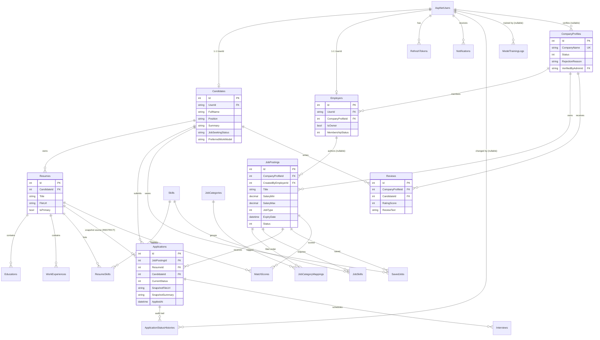

# HotJob — Project Progress

**Last updated:** 2026-10-21
**Note:** Auto-generated from a code/config/migration/git audit. Claims are based on files in this repository; anything not verifiable is marked `Unclear:`. No secrets are reproduced here — config sections list key names only.

---

## 1. Overview

HotJob is a job board plus ATS (Applicant Tracking System) built as a single ASP.NET Core / Blazor Server application.

- Public side: browse published jobs, job detail, company directory, company detail with reviews.
- Candidate side: register/login, profile, "my applications" timeline, notification read API, candidate-to-employer upgrade.
- Employer side: company page (owner/member approval), job CRUD, applicant ATS pipeline, interview scheduling, manual candidate notifications.
- Admin side: role and account seeding only; no admin API or UI in this codebase.
- Intended scope (docs) also includes resume management, apply/save/withdraw, company reviews, ML match scoring, and admin moderation — see the checklist in section 8.

Current state: auth, profile, company management, employer job management and employer ATS are implemented and tested. The candidate apply/save/withdraw/review/resume loop and the admin/ML features are not implemented end to end, so a full hire cycle cannot yet be completed through the product.

---

## 2. Tech Stack

| Area | Choice | Evidence |
|---|---|---|
| Runtime / SDK | .NET 10 (`net10.0`) | `hotjob/hotjob.csproj`, `hotjob/Tests/hotjob.Tests/hotjob.Tests.csproj` |
| Web framework | ASP.NET Core Blazor Web App, Interactive Server render mode | `hotjob/Program.cs`, `hotjob/Components/App.razor`, `hotjob/Components/Routes.razor` |
| API | ASP.NET Core MVC controllers + Swagger/Swashbuckle | `hotjob/Program.cs`, `hotjob/Controllers/*.cs` |
| ORM | EF Core 9.0.0 | `hotjob/hotjob.csproj` |
| Database | MySQL 8.0.36 via Pomelo.EntityFrameworkCore.MySql 9.0.0 | `hotjob/Program.cs`, `hotjob/hotjob.csproj` |
| Identity | ASP.NET Core Identity (`IdentityDbContext<ApplicationUser>`) | `hotjob/Data/ApplicationDbContext.cs`, `hotjob/Program.cs` |
| API auth | JWT Bearer (`Microsoft.AspNetCore.Authentication.JwtBearer` 10.0.5) + Identity | `hotjob/Program.cs` |
| JWT creation | `System.IdentityModel.Tokens.Jwt` 8.16.0 | `hotjob/hotjob.csproj`, `hotjob/Services/Authentication/TokenService.cs` |
| UI styling | Bootstrap 5 assets in `wwwroot/lib` + hand-written CSS per page | `hotjob/wwwroot/css/*.css`, `hotjob/wwwroot/app.css` |
| Tests | xUnit 2.9.3 + Microsoft.NET.Test.Sdk 17.14.1 + EF Core SQLite 9.0.0 in-memory | `hotjob/Tests/hotjob.Tests/hotjob.Tests.csproj`, `hotjob/Tests/hotjob.Tests/Support/TestFixture.cs` |
| JS interop | Small auth bridge for cookie-based session restore | `hotjob/wwwroot/js/auth.js` |

No ML.NET package is referenced, despite ML models and docs describing match scoring.

---

## 3. Architecture

Single deployable ASP.NET Core monolith with two access paths:

1. **Blazor Server components** call application services in-process (`hotjob/Components/Pages/**` → `hotjob/Services/**`). This is the path used by almost all UI after the `refactor/remove-api-loopback-clients` work.
2. **REST controllers** under `/api/**` expose auth, account, public companies, employer jobs, employer ATS, interviews and company management. They share the same services but are mostly not consumed by the Blazor UI.
3. **Browser auth bridge** is the exception: `wwwroot/js/auth.js` calls `/api/auth/login`, `/api/auth/me`, `/api/auth/refresh`, `/api/auth/logout` so the HttpOnly refresh cookie can be set/read by the browser.

Request/startup flow (`hotjob/Program.cs`):

- Optional `.env.local` is loaded from content root / current directory / `hotjob/` and added to configuration; `__` in keys maps to `:`.
- Services registered: Razor components (interactive server), controllers, Swagger with Bearer security definition, DbContext (MySQL, server version 8.0.36), Identity, JWT bearer as default scheme, CORS policy `Frontend`, application services, repositories, seeders, auth state provider.
- On startup: `Database.Migrate()`, then `DatabaseSeeder`, `IdentitySeeder`, `DemoSeeder`.
- Middleware: exception handler → API JSON envelope for `/api` requests, HTTPS redirection, CORS, authentication/authorization, antiforgery, static assets, controller mapping, Blazor hub.

Layering:

- `Models/` — EF entities and enums.
- `Data/` — `ApplicationDbContext`, migrations, seeders.
- `Repositories/` — query composition for jobs, companies, employer data.
- `Services/` — business rules (`ServiceResult<T>`), auth/token rotation, ATS state machine, ownership/guard checks.
- `Controllers/` — thin HTTP mapping via `ApiControllerBase`.
- `DTOs/` — request/response contracts and `ApiResponse<T>` envelope (`success`, `data`, `errors`).
- `Components/` — Blazor pages/layouts and `AuthApiResult` interop model.

Cross-cutting rules found in code:

- Employer endpoints require role `Employer`, an `Active` membership and an `Approved` company (job endpoints especially).
- ATS transitions are forward-only; closing a published job mass-rejects open applications.
- Ownership scoping by `CandidateId` / `CompanyProfileId`; foreign IDs return not found.
- Refresh tokens are stored only as SHA-256 hashes and rotated on refresh; reuse revokes all sessions for the user.

---

## 4. Folder Structure

```text
HotJob/
├─ hotjob/
│  ├─ Program.cs                     # bootstrap, DI, middleware, startup migrate + seed
│  ├─ hotjob.csproj
│  ├─ appsettings.json
│  ├─ appsettings.Development.json
│  ├─ Components/
│  │  ├─ App.razor, Routes.razor, _Imports.razor, RedirectToLogin.razor
│  │  ├─ AuthApiResult.cs
│  │  ├─ Layout/                     # MainLayout, NavMenu, RegisterLayout, ReconnectModal
│  │  └─ Pages/                      # Home, Jobs, JobDetail, Companies, CompanyDetail,
│  │                                 # LoginPage, RegisterPage, Profile, MyApplications,
│  │                                 # BecomeEmployerPage, Employer/{Jobs,Interviews,Company}
│  ├─ Controllers/                   # Auth, Account, Companies, EmployerJobs,
│  │                                 # EmployerApplicants, EmployerInterviews, EmployerCompany
│  ├─ Data/
│  │  ├─ ApplicationDbContext.cs
│  │  ├─ DatabaseSeeder.cs, IdentitySeeder.cs, DemoSeeder.cs
│  │  └─ Migrations/
│  ├─ DTOs/                          # Authentication, Job, Company, Employer, Candidate, ApiResponse
│  ├─ Middleware/                    # API exception/result handling
│  ├─ Models/                        # Users, Resume, Job, Application, ML, Review, SavedJob, Notification
│  ├─ Options (under Services/)      # JwtOptions
│  ├─ Repositories/                  # Company, Employer, Job
│  ├─ Services/                      # Account, Authentication, Candidate, Company, Employer, Job
│  ├─ Tests/hotjob.Tests/            # xUnit test project (not under the app's compile path)
│  └─ wwwroot/                       # app.css, css/*.css, js/auth.js, lib/bootstrap
├─ docs/
│  ├─ project-description.md, task-assignment.md, database-design.md, idea.md
│  ├─ specs/                         # system-shared, candidate, employer, admin, ml-matchscore
│  ├─ superpowers/                   # plans/specs from refactor and job-detail work
│  └─ phuong's doc/                  # design/code-review/unit-test write-ups
├─ DESIGN.md
├─ project.sql                       # standalone MySQL DDL
├─ project.seed.example.sql          # example rows for manual testing
├─ hotjob.slnx
└─ .gitignore
```

No root `README.md`, `Dockerfile`, CI workflow, or `.env.example` was found.

---

## 5. Database & Data Model

Provider: MySQL 8.0.36 via Pomelo. Schema is created by EF migrations at startup; `project.sql` is a standalone equivalent DDL; `project.seed.example.sql` documents one-row-per-table example data and FK flows.

28 tables total: 7 ASP.NET Identity tables + 21 domain tables.

Migrations (`hotjob/Data/Migrations/`):

- `InitialCreate`
- `AddUniqueCompanyName`
- `AddRefreshTokens`
- `EmployerApplicant` — empty Up/Down (schema already covered elsewhere)
- `AdminSeeding` — empty Up/Down
- `CandidateProfilePrefs`

Domain entities (files under `hotjob/Models/`):

| Entity | Table | Key constraints / notes |
|---|---|---|
| `Candidate` | `Candidates` | 1-1 `UserId` → `AspNetUsers`; cascade |
| `Employer` | `Employers` | 1-1 `UserId`; `CompanyProfileId` FK RESTRICT; `IsOwner`, `MembershipStatus` |
| `CompanyProfile` | `CompanyProfiles` | unique `CompanyName`; `Status` Pending/Approved/Rejected; verifier FK SET NULL |
| `RefreshToken` | `RefreshTokens` | unique SHA-256 `TokenHash`; revocation metadata; `UserId` cascade |
| `Resume` | `Resumes` | `CandidateId` cascade; `IsPrimary`, `FileUrl` |
| `Education` | `Educations` | `ResumeId` cascade |
| `WorkExperience` | `WorkExperiences` | `ResumeId` cascade |
| `Skill` | `Skills` | unique `Name` |
| `ResumeSkill` | `ResumeSkills` | PK (`ResumeId`,`SkillId`); `YearsOfExperience` |
| `JobPosting` | `JobPostings` | `CompanyProfileId` cascade; author FK SET NULL; `Status` Draft/Published/Closed/Expired |
| `JobCategory` | `JobCategories` | unique `Name` |
| `JobCategoryMapping` | `JobCategoryMappings` | PK (`JobPostingId`,`JobCategoryId`) |
| `JobSkill` | `JobSkills` | PK (`JobPostingId`,`SkillId`); `ImportanceWeight` |
| `Application` | `Applications` | unique (`JobPostingId`,`CandidateId`); resume/candidate RESTRICT; snapshot fields |
| `ApplicationStatusHistory` | `ApplicationStatusHistories` | append-only trail; changed-by FK SET NULL |
| `Interview` | `Interviews` | `ApplicationId` cascade; `Status` Scheduled/Completed/Cancelled |
| `Review` | `Reviews` | unique (`CompanyProfileId`,`CandidateId`); CHECK rating 1–5 |
| `SavedJob` | `SavedJobs` | PK (`CandidateId`,`JobPostingId`) |
| `Notification` | `Notifications` | `UserId` cascade; in-app only |
| `MatchScore` | `MatchScores` | PK (`JobPostingId`,`ResumeId`); unused by runtime code |
| `ModelTrainingLog` | `ModelTrainingLogs` | trainer FK SET NULL; unused by runtime code |

Enums (stored as INT, documented in `project.sql`):

- `Gender`: Male, Female, Other, PreferNotToSay.
- `MembershipStatus`: Pending, Active, Rejected.
- `CompanyStatus`: Pending, Approved, Rejected.
- `CompanyScale`: LessThan10, From10To49, From50To199, From200To499, MoreThan500.
- `JobStatus`: Draft, Published, Closed, Expired.
- `JobType`: FullTime, PartTime, Contract, Internship, Freelance, Remote.
- `ApplicationStatus`: Pending, Viewed, Shortlisted, Interviewing, Offered, Rejected, Withdrawn.
- `InterviewStatus`: Scheduled, Completed, Cancelled; `InterviewType`: Online, Onsite, Phone.



---

## 6. API Spec

All controllers use `[ApiController]` and the `ApiResponse<T>` envelope (`hotjob/DTOs/ApiResponse.cs`) except model-state validation failures, which return a plain string array from `Program.cs`. Pagination uses `PagedResponse<T>` in most list endpoints.

### Auth — `api/auth` (`hotjob/Controllers/AuthController.cs`)

| Method | Route | Auth | Purpose / notes |
|---|---|---|---|
| POST | `/api/auth/login` | Anonymous | Email/password → access token in body, refresh token in HttpOnly cookie `hotjob_refresh` (path `/api/auth`); generic failure message |
| POST | `/api/auth/refresh` | Anonymous | Prefers refresh cookie, falls back to body `refreshToken`; rotates token, reuse revokes all sessions |
| GET | `/api/auth/me` | Anonymous (cookie-based) | Restores session from refresh cookie without rotating; returns access token + user/roles |
| POST | `/api/auth/logout` | Anonymous (cookie/identity) | Revokes all sessions for the user and clears cookie |

### Account — `api/account` (`hotjob/Controllers/AccountController.cs`)

| Method | Route | Auth | Purpose / notes |
|---|---|---|---|
| GET | `/api/account/profile` | Bearer | Candidate + employer profile union |
| PUT | `/api/account/profile` | Bearer | Update candidate profile fields and/or email; duplicate email → conflict |
| POST | `/api/account/change-password` | Bearer | Verifies current password; revokes sessions on success |
| POST | `/api/account/register` | Anonymous | Candidate or employer registration (`AccountType` 1/2); employer creates a company or joins by `CompanyProfileId` |
| POST | `/api/account/become-employer` | Bearer | Adds employer profile/role to an existing user; create company or join |

### Companies (public) — `api/companies` (`hotjob/Controllers/CompaniesController.cs`)

| Method | Route | Auth | Purpose / notes |
|---|---|---|---|
| GET | `/api/companies` | Anonymous | Approved companies only; `search`, `industries[]`, `locations[]`, `page`; fixed page size 20 |
| GET | `/api/companies/filters` | Anonymous | Distinct industry/location options from approved companies |

Company detail (`GetDetailAsync`) and reviews (`GetReviewsAsync`) exist in `hotjob/Services/Company/CompanyService.cs` but have no controller; Blazor pages call them directly.

### Employer jobs — `api/employer/jobs` (`hotjob/Controllers/EmployerJobsController.cs`)

Requires role `Employer`; service additionally requires Active membership + Approved company.

| Method | Route | Purpose / notes |
|---|---|---|
| POST | `/api/employer/jobs` | Create Draft/Published job with categories + skills; validates salary range, future expiry |
| GET | `/api/employer/jobs` | Own-company jobs; `status`, `search`, `page`, `pageSize`; application counts |
| GET | `/api/employer/jobs/{id:int}` | Own-company job detail; foreign ID → 404 |
| PUT | `/api/employer/jobs/{id:int}` | Update scalar fields + atomic replace of skills/categories |
| DELETE | `/api/employer/jobs/{id:int}` | Draft → delete row; Published → close + mass-reject open applications |
| PUT | `/api/employer/jobs/{id:int}/categories` | Replace categories |
| PUT | `/api/employer/jobs/{id:int}/skills` | Replace skills and weights |

### Employer applicants / ATS — `api/employer/applications` (`hotjob/Controllers/EmployerApplicantsController.cs`)

| Method | Route | Purpose / notes |
|---|---|---|
| GET | `/api/employer/applications` | List scoped to own company; filter by job/status, search name/email, paging |
| GET | `/api/employer/applications/{id:int}` | Detail with resume, education, experience, skills, history |
| PATCH | `/api/employer/applications/{id:int}/status` | Forward-only ATS transition; same status = no-op; writes history + notifies candidate |
| POST | `/api/employer/applications/{id:int}/notify` | Manual in-app notification to candidate |
| POST | `/api/employer/applications/{id:int}/interviews` | Schedule interview; Shortlisted auto-advances to Interviewing; terminal → conflict |
| GET | `/api/employer/applications/{id:int}/interviews` | List interviews for the application |

### Employer interviews — `api/employer/interviews` (`hotjob/Controllers/EmployerInterviewsController.cs`)

| Method | Route | Purpose / notes |
|---|---|---|
| PUT | `/api/employer/interviews/{id:int}` | Reschedule/edit interview |
| DELETE | `/api/employer/interviews/{id:int}` | Cancel interview |

### Employer company — `api/employer/company` (`hotjob/Controllers/EmployerCompanyController.cs`)

| Method | Route | Purpose / notes |
|---|---|---|
| GET | `/api/employer/company` | Company page with members and owner flag; pending member blocked |
| PUT | `/api/employer/company` | Owner updates company fields |
| POST | `/api/employer/company/members/{id:int}/approve` | Owner activates pending member |
| POST | `/api/employer/company/members/{id:int}/reject` | Owner rejects pending member |

Not implemented: public jobs REST API (`JobService.BrowsePublishedAsync`/`GetPublishedAsync` are called directly by Blazor), candidate apply/save/withdraw/review/resume endpoints, notification list endpoints, admin endpoints, ML endpoints.

---

## 7. Authentication & Authorization

- ASP.NET Core Identity stores users in `AspNetUsers`; roles seeded as `Admin`, `Candidate`, `Employer` (`hotjob/Data/IdentitySeeder.cs`).
- Default authentication scheme is JWT Bearer; controllers that require auth also explicitly set `AuthenticationSchemes = JwtBearerDefaults.AuthenticationScheme` for employer controllers.
- Access token: HMAC-signed JWT with user ID, email, display name, roles; lifetime `Jwt:AccessTokenMinutes` (validation allows 1–1440).
- Refresh token: random URL-safe value, stored only as SHA-256 hex in `RefreshTokens`; lifetime `Jwt:RefreshTokenDays` (legacy `Jwt:SessionTokenDays` honored).
- Refresh is delivered as HttpOnly cookie `hotjob_refresh`, path `/api/auth`, `Secure` when the request is HTTPS. Response body never contains the refresh token.
- Rotation: each refresh revokes the old row, links `ReplacedByTokenHash`, and issues a new token. Reusing a revoked token revokes all sessions for that user.
- Logout revokes all sessions for the resolved user and clears the cookie.
- Disabled accounts (`ApplicationUser.IsActive == false`) are rejected at login, refresh, and session restore.
- Blazor Server auth state is per-circuit: `HotJobAuthStateProvider` holds in-memory `AuthTokens`; on first render `RedirectToLogin`/auth bridge calls `GET /api/auth/me` to restore from the cookie, then signs in the circuit.
- Authorization rules:
  - `AccountController`: authenticated except `register`.
  - `CompaniesController`: anonymous.
  - Employer controllers: `[Authorize(Roles = "Employer")]` plus service-level guard (`EmployerGuard`) for Active membership + Approved company.
  - Candidate-scoped service methods resolve `CandidateId` from claims and return unauthorized/not-found on missing profile or foreign rows.
- Password policy comes from Identity defaults with DTO-level complexity regex (uppercase, lowercase, digit, special character; min 6).
- Antiforgery is enabled for the Blazor app; API controllers are stateless JWT/cookie endpoints.
- `Unclear:` whether a formal rate limit / lockout policy beyond Identity defaults is applied; no rate-limiter registration was found in `Program.cs`.

---

## 8. Feature Checklist

Legend: ✅ implemented and wired · 🚧 partial/scaffold · ⏳ data model only · ❌ absent.

### Authentication / account

| Feature | Status | Evidence |
|---|---|---|
| Candidate registration | ✅ | `AccountService.RegisterAsync`, `RegisterPage.razor` |
| Employer registration (create company / join company) | ✅ | `AccountService.RegisterAsync`, `RegisterEmployerTests` |
| Login / logout / refresh / session restore | ✅ | `AuthService`, `AuthController`, `wwwroot/js/auth.js` |
| Refresh-token rotation + reuse detection | ✅ | `TokenService`, `RefreshTests` |
| Candidate → employer upgrade | ✅ | `AccountService.UpgradeToEmployerAsync`, `/become-employer` |
| Profile view/update | ✅ | `AccountService`, `Profile.razor` |
| Change password | ✅ | `AccountService.ChangePasswordAsync` |
| Role-based route/API gating | ✅ | `Routes.razor`, `RedirectToLogin.razor`, `[Authorize]` |
| Email confirmation / password reset / external login | ❌ | no endpoints or UI; Identity tables only |
| Admin user management / lock-unlock | ❌ | no admin controller/service/UI |

### Public job board / companies

| Feature | Status | Evidence |
|---|---|---|
| Browse published jobs with filters | ✅ | `JobService.BrowsePublishedAsync`, `Jobs.razor` (`/it-jobs`) |
| Job detail (published, non-expired) | ✅ | `JobService.GetPublishedAsync`, `JobDetail.razor` |
| Company directory + filters | ✅ | `CompanyService`, `Companies.razor` + `/api/companies` |
| Company detail + reviews read | ✅ | `CompanyDetail.razor`, `CompanyService.GetReviewsAsync` |
| Write/edit company review | ❌ | `Reviews` table + read only |
| Public jobs REST API | ❌ | no `JobsController`; Blazor calls service directly |
| Job expiry sweep | 🚧 | expired jobs filtered at read time; no background job found |

### Candidate

| Feature | Status | Evidence |
|---|---|---|
| My applications timeline | ✅ | `CandidateService.GetMyApplicationsAsync`, `MyApplications.razor` |
| Notifications read/mark-read service | ✅ | `CandidateService.GetMyNotificationsAsync` / `MarkNotificationReadAsync` |
| Notifications UI | ❌ | no notification page/component found |
| Resume CRUD (education, experience, skills) | ❌ | models exist; no service/controller; Profile CV list is hardcoded mock |
| CV file upload | ❌ | `Resume.FileUrl`/`SnapshotFileUrl` fields only; drag-drop UI is a no-op |
| Apply to job + cover letter + snapshot freeze | ❌ | seeded demo `Application` row only; no apply endpoint/service |
| Save / unsave job | ❌ | `SavedJobs` table unused |
| Withdraw application | ❌ | enum value exists; no candidate endpoint |
| MatchScore display | ⏳ | `MatchScore` entity only; no calculation service/UI |

### Employer

| Feature | Status | Evidence |
|---|---|---|
| Company page, owner update | ✅ | `Employer/CompanyService`, `Company.razor` |
| Approve/reject joining members | ✅ | `EmployerCompanyController`, `CompanyService` |
| Job create/update/delete-or-close | ✅ | `JobService`, `Employer/Jobs.razor`, `EmployerJobCrudTests` |
| Category/skill assignment | ✅ | `JobService.AssignCategoriesAsync` / `AssignSkillsAsync` |
| Applicant list/detail with company scoping | ✅ | `ApplicantService`, `EmployerAtsTests` |
| ATS status transitions + history + notification | ✅ | `ApplicantService.UpdateStatusAsync`, tests |
| Interview create/list/update/cancel | ✅ | `InterviewService`, `Employer/Interviews.razor` |
| Manual candidate notification | ✅ | `NotificationService`, `EmployerApplicantsController` |
| Employer analytics/reporting | ❌ | none found |
| Draft-only job editing restrictions | 🚧 | close/delete behavior implemented; `Unclear:` exact field editability after Publish beyond service validation |

### Admin / ML / platform

| Feature | Status | Evidence |
|---|---|---|
| Admin role + admin account seeding | ✅ | `IdentitySeeder`, `Seed:Admins` |
| Admin company approve/reject | ❌ | no admin service/controller/UI |
| Admin job moderation | ❌ | spec only (`docs/specs/admin.md`) |
| ML.NET model training | ❌ | no ML.NET package, no trainer service |
| Match score calculation (rule or model) | ❌ | model/table/log only |
| File storage / CV upload | ❌ | no storage integration |
| Email / SMS / push | ❌ | in-app `Notifications` only |
| Docker / CI/CD | ❌ | no `Dockerfile`, `.github`, or pipeline files found |
| API docs | ✅ | Swagger at `/swagger` in Development |

---

## 9. Frontend

Blazor Server UI (`hotjob/Components/Pages/**`). Styling is per-page CSS under `hotjob/wwwroot/css/`, with Bootstrap assets vendored in `hotjob/wwwroot/lib/bootstrap`.

| Route | Component | Data source | Notes |
|---|---|---|---|
| `/` | `Home.razor` | services / static content | Landing page |
| `/it-jobs` | `Jobs.razor` | `IJobService.BrowsePublishedAsync` | Search/filter job list |
| `/jobs/{id:int}` | `JobDetail.razor` | `IJobService.GetPublishedAsync` | Detail; apply action not implemented |
| `/companies` | `Companies.razor` | `ICompanyService` / `/api/companies` | Company directory |
| `/companies/{id:int}` | `CompanyDetail.razor` | `ICompanyService` | Detail + reviews read |
| `/login` | `LoginPage.razor` | `wwwroot/js/auth.js` → `/api/auth/*` | Cookie-based session |
| `/register` | `RegisterPage.razor` | `IAccountService` directly | Candidate/employer registration |
| `/profile` | `Profile.razor` | `IAccountService` directly | Profile edit; CV section is mock |
| `/my-applications` | `MyApplications.razor` | `ICandidateService` | Application timeline |
| `/become-employer` | `BecomeEmployerPage.razor` | `IAccountService` | Upgrade flow |
| `/employer/jobs` | `Employer/Jobs.razor` | `IJobService` directly | CRUD jobs |
| `/employer/interviews` | `Employer/Interviews.razor` | interview/applicant services | Schedule/edit/cancel |
| `/employer/company` | `Employer/Company.razor` | `ICompanyService` (employer) | Company + members |
| `/weather` | `Weather.razor` | static demo data | Leftover template page |
| `/Error`, `/not-found` | `Error.razor`, `NotFound.razor` | — | Default error/not-found views |

Layouts: `MainLayout.razor` + `NavMenu.razor` for the app, `RegisterLayout.razor` for auth/marketing pages. `Routes.razor` uses `AuthorizeRouteView` and `RedirectToLogin`; authorization is role-based but most route protection is in-service.

`Unclear:` no dedicated ARIA/accessibility audit was performed; markup includes some ARIA labels but coverage is not documented.

---

## 10. Integrations

| Integration | Status | Evidence |
|---|---|---|
| MySQL | ✅ | connection string `ConnectionStrings:DefaultConnection`; Pomelo provider |
| Swagger / OpenAPI | ✅ | `Program.cs`; Bearer security definition |
| CORS | ✅ | policy `Frontend` from `Cors:AllowedOrigins`; allows credentials |
| Browser JS interop auth bridge | ✅ | `hotjob/wwwroot/js/auth.js` |
| Email provider | ❌ | none |
| SMS / push | ❌ | none |
| Cloud file storage (CV/avatar) | ❌ | URL fields only; no upload service |
| Payment | ❌ | none |
| ML.NET | ❌ | package/model absent |
| External OAuth (Google/LinkedIn) | ❌ | Identity tables support logins; no provider registration |

---

## 11. Configuration & Environment

Configuration sources: `hotjob/appsettings.json`, `hotjob/appsettings.Development.json`, environment variables, and optional `.env.local` loaded manually by `Program.cs`.

Key names only (values intentionally omitted):

| Section / key | Purpose |
|---|---|
| `ConnectionStrings:DefaultConnection` | MySQL connection |
| `Logging:LogLevel:Default`, `Logging:LogLevel:Microsoft.AspNetCore` | Logging levels |
| `Cors:AllowedOrigins` | Allowed browser origins for the `Frontend` policy |
| `Jwt:SecretKey` | HMAC signing key (validated `[Required, MinLength(32)]`) |
| `Jwt:Issuer` | Token issuer |
| `Jwt:Audience` | Token audience |
| `Jwt:AccessTokenMinutes` | Access-token lifetime |
| `Jwt:RefreshTokenDays` | Refresh-token lifetime |
| `Jwt:SessionTokenDays` | Legacy refresh lifetime fallback |
| `Seed:Admins[]:Email`, `Seed:Admins[]:Password` | Admin accounts to seed |
| `Seed:Demo:CompanyName` | Demo company |
| `Seed:Demo:EmployerEmail`, `EmployerPassword`, `EmployerName` | Demo employer |
| `Seed:Demo:CandidateEmail`, `CandidatePassword`, `CandidateName` | Demo candidate |
| `AllowedHosts` | Host filtering |

Environment notes:

- `ASPNETCORE_ENVIRONMENT=Development` enables Swagger and detailed errors via launch profile.
- `.env.local` is optional; keys may use `__` for section separators. No `.env.example` exists.
- `.gitignore` lists `hotjob/appsettings.json`, yet the file is tracked (`git status` shows it modified); the ignore rule does not untrack it.
- **Security concern:** `hotjob/appsettings.json` holds committed development credentials (DB password, JWT signing key, seeded admin/demo passwords). Values are not reproduced here. Rotate/replace with user secrets or environment variables before any shared or deployed environment.
- `hotjob/Data/DemoSeeder.cs` also contains hardcoded demo/reviewer passwords (values omitted).

---

## 12. How to Run

Prerequisites: .NET 10 SDK, MySQL 8.0.x (code targets 8.0.36), optional `dotnet-ef` for manual migrations.

1. **Database**
   - Option A: let the app migrate on startup (requires an existing empty `hotjob` database and permissions).
   - Option B: run the standalone schema and optional sample data:
     ```bash
     mysql -u root -p < project.sql
     mysql -u root -p hotjob < project.seed.example.sql
     ```
   - Ensure `ConnectionStrings:DefaultConnection` points at your MySQL instance.
2. **Configuration**
   - Create `hotjob/.env.local` (or repo-root `.env.local`) with overrides such as `ConnectionStrings__DefaultConnection=...` and `Jwt__SecretKey=...`; or use `dotnet user-secrets`.
   - Do not reuse the committed development credentials outside local development.
3. **Build**
   ```bash
   dotnet restore hotjob.slnx
   dotnet build hotjob.slnx
   ```
4. **Run**
   ```bash
   dotnet run --project hotjob/hotjob.csproj
   ```
   Launch profiles (`hotjob/Properties/launchSettings.json`): `http` → `http://localhost:5168`; `https` → `https://localhost:7023` and `http://localhost:5168`.
5. **Swagger**: open `/swagger` in Development.
6. **Seed accounts**: created at startup from `Seed:Admins` and `Seed:Demo`; use the configured values. Seeding is idempotent and skips existing emails.
7. **Tests**
   ```bash
   dotnet test hotjob/Tests/hotjob.Tests/hotjob.Tests.csproj
   ```

Startup order matters: seeding runs after `Database.Migrate()`, so an unreachable database prevents the app from starting.

---

## 13. Testing

- Test project: `hotjob/Tests/hotjob.Tests/hotjob.Tests.csproj`; included in `hotjob.slnx`.
- Framework: xUnit 2.9.3, Microsoft.NET.Test.Sdk 17.14.1, coverlet collector 6.0.4.
- Database under test: EF Core SQLite in-memory via `Support/TestFixture.cs`; Identity password options mirrored from the app.
- Scale: 28 test files, 165 `[Fact]`/`[Theory]` test methods (Theory data rows add more cases).

Coverage by area:

| Area | Files | What is covered |
|---|---|---|
| Auth | `AuthTests/*` (9 files) | login, refresh rotation/reuse, logout, session restore, token claims/lifetime, cookie behavior, display name, `AuthApiResult` |
| Registration | `RegisterTests/*` (5 files) | candidate/employer happy paths + validation, join/create company, duplicate company/email, upgrade to employer |
| Profile | `ProfileTests/*` (2 files) | union profile read, field trimming, duplicate email conflict, password change + session revocation |
| Jobs | `JobTests/*` (2 files) | employer create/get/update roundtrip, draft delete vs published close, unauthorized employer, public detail visibility |
| ATS | `EmployerTests/EmployerAtsTests.cs` | company scoping, search/status/paging, detail payload, forward-only transitions, history + notifications, interview rules, manual notify |
| Guards | `EmployerTests/EmployerGuardTests.cs` | rejected company blocked from list/status/interview |
| Companies | `CompanyTests/*` (3 files) | approved-only listing, filters, paging, detail, reviews, owner update, member approve/reject, controller mappings |
| Candidate | `CandidateTests/CandidateServiceTests.cs` | own applications + ordering, authorization, notifications read/mark-read |
| Seed | `SeedTests/*` (2 files) | idempotent identity/demo seeding, catalog companies, reviews, empty config |
| Common | `CommonTests/*` (2 files) | API result mapping, exception-to-envelope behavior |

Gaps: no tests for candidate apply/withdraw/save, resume CRUD, review writing, admin moderation, ML scoring/training, or end-to-end browser flows. Test suite was **not executed during this audit** (shell tooling unavailable); pass/fail status is unverified.

---

## 14. Known Issues / TODOs

- **Secrets committed** in `hotjob/appsettings.json` (DB password, JWT key, seed passwords) despite `.gitignore` entry; also hardcoded demo passwords in `hotjob/Data/DemoSeeder.cs`. Rotate before deployment.
- **Candidate core loop missing:** no apply, save/unsave, withdraw, resume CRUD, or review-write features. `Applications`/`SavedJobs` are effectively seed/demo-only.
- **Admin features absent:** `Admin` role is seeded but no admin service, controller, or UI for company approval, user lock/unlock, or moderation. `docs/specs/admin.md` describes intended behavior only.
- **ML absent:** `MatchScore` and `ModelTrainingLog` exist, but no ML.NET package, trainer, scoring service, or UI.
- **Split architecture:** Blazor components bypass the REST API by calling services in-process; only auth uses `/api`. Public job browsing and company detail therefore have no REST endpoints.
- **Mock UI areas:** Profile CV list is hardcoded; CV upload/drag-drop does nothing; `/weather` is leftover template code; default `Error.razor` remains.
- **Empty migrations:** `EmployerApplicant` and `AdminSeeding` have empty Up/Down; schema changes must have been folded into other migrations or applied manually. `Unclear:` whether a fresh database fully matches `project.sql`.
- **No public jobs API**, no notifications UI, no email/SMS/storage integration.
- **No README, Dockerfile, CI/CD, or `.env.example`.**
- **Refresh cookie scope** is `/api/auth`; any future non-API auth endpoint must account for that path.
- **Validation response shape inconsistency:** `Program.cs` model-state failures return a string array, while services return `ApiResponse<T>`; clients must handle both.
- **Potential CSRF surface:** refresh/logout rely on an HttpOnly cookie; CORS is restricted, but no explicit anti-CSRF token is used for those API calls (same-site cookie settings not verified).
- **`Unclear:`** production hosting assumptions, backup/migration strategy, and whether `dotnet test` currently passes.
- TODO/FIXME comments in first-party code: none found outside vendored Bootstrap and design docs under `docs/phuong's doc/`.

---

## 15. Next Steps

Ordered by impact on a working end-to-end product:

1. **Remove committed secrets** from `hotjob/appsettings.json` and `DemoSeeder`; move to user secrets/environment variables and rotate any exposed values.
2. **Close the candidate loop:** resume CRUD + file storage, apply with snapshot freeze, save/unsave, withdraw, review write, notifications UI. Add candidate REST endpoints alongside existing services.
3. **Add public jobs API** (list/detail) or explicitly document the in-process-only architecture; align Swagger with the actual UI surface.
4. **Implement admin module:** company approve/reject with reason + notifications, user search/lock/unlock, training-log view.
5. **Implement match scoring:** start with the weighted-rule formula from `docs/specs/ml-matchscore.md`, then add ML.NET training behind a feature/data threshold.
6. **Add regression tests** for apply/withdraw/resume/review/admin and an end-to-end hire-cycle test.
7. **Platform hardening:** README, `.env.example`, Dockerfile, CI workflow (build + tests), structured logging, rate limiting, and a background job for job expiry.
8. **Clean up:** remove `/weather`, replace default error page, resolve empty migrations, and verify schema parity between EF migrations and `project.sql`.

---

## 16. Recent Activity

Current branch: `phat`; HEAD `e8dc818` ("Merge branch 'dev' into phat"). Remote `origin/phat` points at the same commit. `main` is at `6ce633a` ("Viết doc mô tả"), so `phat` contains additional work.

Recent commits (newest first, from `.git/logs`):

| Commit | Message |
|---|---|
| `e8dc818` | Merge branch 'dev' into phat |
| `98a5baa` | become employer |
| `3f7f09d` | Update sang.md |
| `6e13ff4` | Refine company detail page |
| `f1ee87f` | refactor: switch company job filtering from name to ID |
| `97229c3` | doc |
| `a7b00e2` | Moved docs |
| `9eb6870` | refactor: delete Services/Api loopback clients and dead DTO |
| `7fdcb61` | refactor: Employer Jobs page uses IJobService directly |
| `e631b80` | refactor: Employer Company page uses ICompanyService directly |
| `95d378b` | refactor: Profile uses IAccountService directly |
| `81f233d` | refactor: RegisterPage uses IAccountService directly |
| `b111ed5` | refactor: fix JobDetailResponse test constructors |
| `6ce633a` | Viết doc mô tả (main) |

Other branches present: `main`, `dev`, `PhuongSoCute`, `phat`, plus remote branches `dan`, `dev`, `main`, `midu`, `phat`, `quang_branch`, `refactor/remove-api-loopback-clients`, `yeu-quai-xau-xa`.

Uncommitted change: `hotjob/appsettings.json` modified. No other tracked changes were reported by `git status --short` at audit time.

Documentation added recently: `DESIGN.md` (as-built UI audit), `docs/project-description.md`, `docs/task-assignment.md`, `docs/database-design.md`, `docs/specs/*`, and refactor plans under `docs/superpowers/`.
